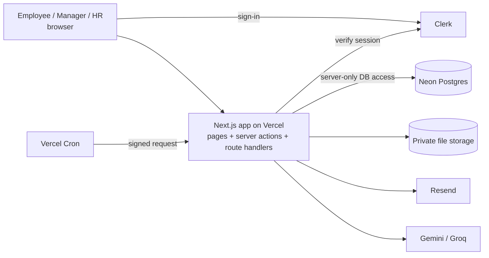
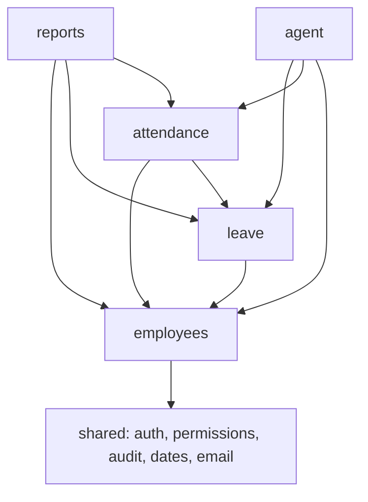
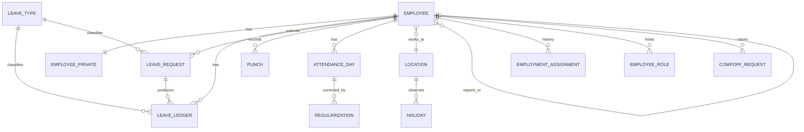

# HRMS Architecture

How the Konkan Coastal Foods HRMS is built. Business rules live in [RESEARCH.md](RESEARCH.md) (rule numbers like R2 refer to section 9 there) and `docs/requirements.pdf`; screens are in [DESIGN.md](DESIGN.md). Changes to any decision here are recorded first in [docs/decisions.md](docs/decisions.md).

**Context:** one company, 180 employees, head office in Panaji and a plant in Verna, Goa. All times are IST (Asia/Kolkata).

## 1. Goals and scope

**Version 1 covers:**
- Employee Master with immutable employee codes
- Attendance: raw punches, derived daily status, regularization, WFH
- Leave: types, ledger-based balances, apply / approve / cancel, accrual and year-end jobs
- Holiday calendars per location
- Reports
- An HR assistant agent
- Roles, access control and audit log

**Out of scope for v1:** payroll calculation, statutory filings (PF/ESI/TDS), recruitment, performance reviews, multi-company tenancy.

**Quality goals, in priority order:**
1. **Correctness and auditability** - every balance and status can be explained from stored records.
2. **Privacy and security** - Aadhaar, PAN, bank and salary data are protected (RESEARCH.md section 1, DPDP Act).
3. **Configurability** - leave rules, holidays and thresholds are data, not code.
4. **Simplicity** - small team, one deployable app, managed services.

## 2. Tech stack

| Layer | Choice | Why |
|---|---|---|
| App framework | Next.js (App Router, TypeScript) on Vercel | One codebase for UI and server code; simple deploys |
| Database | Neon (PostgreSQL), pooled connection via `@neondatabase/serverless` | Transactions, constraints and row locks for ledgers; branches for dev and staging; point-in-time restore |
| Auth | Clerk | Hosted sign-in, sessions and user management; roles stored in Clerk metadata and mirrored in the database |
| Email | Resend | Approval and reminder emails |
| Scheduled jobs | Vercel Cron calling protected route handlers | Monthly accrual, year-end, escalations, reminders |
| File storage | Private S3 bucket in Mumbai with signed URLs (proposed, not yet decided) | Neon has no storage; medical certificates and documents need a private home |
| Agent LLM | Gemini or Groq via their APIs | HR assistant (section 8) |
| Validation | Zod | Same schemas for forms and server inputs |
| Tests | Vitest, Playwright | Rule logic and end-to-end flows |
| CI | GitHub Actions | Lint, typecheck, test, build on every PR |

Regions: Neon has no Mumbai region, so the database goes in Singapore (`aws-ap-southeast-1`) and Vercel functions are pinned to `sin1` to keep app and database close. Employee data therefore sits outside India; confirm this is acceptable (DPDP, company policy) before real data is loaded. See docs/decisions.md.

## 3. System overview



**Style: modular monolith.** All logic runs on the server side of one Next.js app. The browser never talks to the database directly. The database is reached only from server code using the Neon connection string held in server environment variables, and every request is authorised in server code before any query runs.

## 4. Modules

Code is organised by module. Each module owns its tables, its server logic and its UI.

| Module | Responsibility |
|---|---|
| **employees** | Employee master, employee code generation, org structure (department, manager, location), statutory IDs, bank details, roles |
| **attendance** | Raw punches, daily status derivation, regularization, WFH requests, month lock |
| **leave** | Leave types and policy config, ledger, applications, approvals, accrual and year-end jobs, holiday calendars |
| **reports** | Read-only reports: leave balances, leave taken, attendance summary, late marks, headcount |
| **agent** | HR assistant: chat endpoint, tool definitions that call the other modules, role-aware guardrails |
| **shared** (not a module) | Auth helpers, permission checks, audit logging, IST date utilities, email, error types |



Rule: a module uses another only through its exported service functions, never by querying its tables. Holidays belong to **leave** because leave day counting and attendance status both depend on them; attendance reads them through leave's service.

## 5. Data model (core entities)



| Entity | Key fields and notes |
|---|---|
| **employee** | `id` (UUID), `employee_code` (unique, immutable: existing codes imported as issued, new ones from a sequence that continues after the highest code, per P6), name, DOB, gender, joining date, exit date, status, `clerk_user_id` (set only after a verified invite is accepted, per P2). Current location, manager, department and employment type are read from the open `employment_assignment` row. Never hard-deleted; set inactive instead (RESEARCH.md section 2). |
| **employment_assignment** | Effective-dated history (P5): employee, location, department, manager, grade, employment type, `effective_from`, `effective_to` (null for the current row). No overlaps per employee; no reporting loops. Holidays, weekly offs, approvers and reports resolve the row effective on the date in question. |
| **employee_role / role** | An employee can hold several roles (employee, HR admin, system admin; manager is derived from reporting lines). The database is the only source of roles (P2). |
| **employee_private** | PAN, UAN, bank account, IFSC, salary, encrypted at the application layer with a key held outside the database credentials and a key version per row (P7). PAN also has a keyed hash (blind index) for de-duplication. Aadhaar: only the last 4 digits and a verified flag; the full number is not stored (P7). Every read of a full value is audited. |
| **location** | Panaji head office, Verna plant. Name, state, weekly-off pattern, timezone. Drives which holiday list applies. |
| **holiday** | `location_id`, date, name, type (national / state / restricted). Unique per (location, date). |
| **leave_type** | Code (CL, SL, EL, MAT, PAT, COMPOFF, LOP), accrual mode, quota, carry-forward cap, encashable, max consecutive days, gender restriction, expiry days, statutory floor, effective-from. Rules R6 to R12 live here as data. |
| **leave_ledger** | Append-only (P4): `employee_id`, `leave_type_id`, `leave_year`, `entry_date`, `delta` as `numeric(5,1)` in half-day steps, `reason` (accrual, opening_balance, pending_hold, hold_release, application, cancellation, lapse, carry_forward, encashment, expiry, adjustment), `expires_on` (on credits that expire), `consumes_entry_id` (debits consume the earliest-expiring credit first), `ref_id`. Balance = sum of non-hold rows (R2, R25); available = balance minus open holds. UPDATE and DELETE are revoked at database level; fixes are new rows. |
| **leave_request** | Employee, type, start, end, half-day flag and half, reason, status (pending / approved / rejected / cancelled), approver, decided at, attachment path. Maternity and paternity requests also carry expected delivery or birth date and child count and are checked for eligibility; they are tracked on the request, not as a day balance (P4). |
| **compoff_request** | Employee, worked date, reason, status. Approval writes a ledger credit with its own `expires_on` (R11, P4). |
| **punch** | Employee, timestamp (stored UTC), direction, source. Immutable. |
| **attendance_day** | Employee, date, derived status (present / half_day / absent / leave / holiday / weekly_off / wfh), first in, last out, hours, late flag, `locked`. |
| **regularization** | Day, requested status or times, reason, status, approver. Approving changes `attendance_day`, never `punch` (R28). |
| **wfh_request** | Employee, date, status. |
| **job_run** | Job name, period, started / finished, result. Idempotency key for cron jobs. |
| **audit_log** | Actor, action, entity, entity id, summary, timestamp. Append-only. Also records views of sensitive fields and agent tool calls. |
| **agent_conversation / agent_message** | Chat history per employee, with the tool calls made. Retention limited and covered by the privacy rules. |

## 6. Key design decisions

1. **Leave balance is a ledger.** A balance is `SUM(delta)` per employee and type. Submitting a request writes a hold; approval converts it to a debit in the same transaction, and rejection or cancellation releases it. Credits that expire (comp-off) are consumed earliest-expiry first (P4).
2. **Server-side authorization with the database as the source of roles.** Clerk proves identity only. Every request loads the current employee, roles and assignment from the database; no role claim in a token is trusted, and deactivating an employee blocks access at once (P2). Sign-up is invite-only: HR creates the employee row, the invite is accepted with a verified email, then `clerk_user_id` is linked. Unlinked Clerk users have no access. Approval rules: nobody approves their own request; a requester with no manager, or whose manager is the requester, goes to HR; HR's own requests go to a designated second approver. Hiding a button is never the control.
3. **One enforced data-access layer (P3).** All database access goes through each module's data-access functions, which require the acting user and apply scoping inside the query (own data, direct reports, everyone). Routes, server actions and server components never import the database client; a lint rule and a CI check enforce this, and every new endpoint ships with a permission test. The app connects with a non-owner application role that has only the privileges it needs (UPDATE and DELETE revoked on ledger and audit tables), Row Level Security stays enabled as a second barrier, and the connection string lives only in server environment variables.
4. **Concurrency.** Approving or applying leave locks the employee's balance row for that leave type (`SELECT ... FOR UPDATE`) inside a transaction so two requests cannot spend the same day. These operations are implemented as Postgres functions (called via RPC) or transactions with explicit locks, since serverless functions are stateless.
5. **Idempotent jobs.** Each cron run is keyed by job + employee + period in `job_run` and `ref_id`; rerunning creates no duplicates. Cron routes verify a secret and are safe to retry.
6. **Policy as data.** Quotas, caps and thresholds come from `leave_type` and an attendance policy row, with effective dates so old calculations remain reproducible.
7. **Raw vs derived attendance.** Punches are facts; `attendance_day` is recomputed from punches, leave, holidays and WFH, and frozen by the month lock.
8. **More generous of statute and policy.** Entitlement is `max(policy, statutory_floor)` per type (R4, R8).
9. **Immutable employee code.** Existing codes are kept as issued at import; new codes come from a sequence that continues after the highest numeric code. UPDATE is revoked on the column (trigger as backup) and it is absent from every update schema (P6).
10. **IST everywhere.** Timestamps stored as UTC and converted with `Asia/Kolkata` for any date logic (late marks, month boundaries, cron schedules). Leave and holiday dates are plain `date` values. Vercel Cron runs in UTC, so schedules are written as UTC equivalents of the IST times (for example 00:30 IST = 19:00 UTC the previous day), with the conversion documented next to each schedule. All date helpers live in one shared module so no code relies on the server's local time.
11. **Location-based holidays.** Holidays and weekly offs come from the location on the employee's assignment effective on that date, for example Panaji or Verna, with Goa's calendar (R3, P5).
12. **Serverless-friendly.** No in-memory state or long-running processes. Long work is split into small cron-triggered batches per employee chunk.

## 7. Request flow example: apply for leave

1. The employee submits the form, which calls a server action.
2. The server verifies the Clerk session, loads the employee and role, and validates input with Zod.
3. The leave service checks: employee is active (R5), dates valid and within the backdating limit (R19), no overlap (R17), type rules like gender and max consecutive days (R6, R9, R10), and the working-day count after weekly offs and holidays (R3).
4. It checks the ledger balance (R18); a shortfall is rejected unless the employee chose LOP.
5. The request is saved as pending; Resend emails the manager.
6. On approval, one transaction writes the ledger debit, updates the request, and writes the audit entry. After commit, the employee is emailed and attendance days are recomputed.
7. If the manager does nothing for 5 working days, the daily escalation cron emails HR (R20).

## 8. HR assistant agent

**What it does:** answers questions like "How many CL do I have left?", "When is the next holiday at Verna?", "What is the late-mark rule?", and can start simple actions such as drafting a leave request for the user to confirm.

**Design:**
- Runs on the server in the agent module. The LLM (Gemini or Groq) never gets database access. It can only call a fixed set of **tools**, each a thin wrapper over an existing module service function (get my balances, list my requests, list holidays for my location, explain a policy rule, prepare a leave application).
- Every tool runs with the **signed-in user's** permissions, using the same permission checks as the UI. The model cannot widen access by asking for another employee's data.
- **Sensitive data:** tools never return unmasked Aadhaar, PAN or bank details. Salary is excluded. Prompts and tool results sent to the LLM contain the minimum needed.
- **Actions need confirmation:** the agent can prepare a leave request, but submitting requires an explicit click in the UI, not a model decision.
- **Grounding:** policy answers come from `leave_type` data and RESEARCH.md rules loaded as context or retrieved, not from the model's memory. When unsure, it says so and points to HR.
- **Safety:** treat user text and tool outputs as untrusted (prompt injection); no tool performs deletes or role changes; rate limits per user; all tool calls are written to `audit_log`.
- **Provider abstraction:** a small interface wraps the model call so Gemini and Groq can be swapped by configuration; keys live in environment variables.
- **Privacy:** an employee's conversations are visible only to them; retention is limited (for example 90 days), and the data falls under the DPDP rules in section 9.

## 9. Security and privacy

- **Authentication:** Clerk handles passwords, MFA options and sessions, with invite-only sign-up. Server code verifies the session on every request and then loads roles from the database (P2).
- **Authorization:** role-based plus relationship checks. Employees see their own data, managers their direct reports, HR everyone, and only designated roles see employee_private. Checks sit in the shared permission module and are tested.
- **Data protection:** TLS, Neon encryption at rest, application-level encryption of PAN / UAN / bank / salary fields with a key kept separate from the database credentials and versioned for rotation, no storage of the full Aadhaar number (last 4 digits only), a blind index on PAN, masking in all API responses and UI. Reveal is enforced on the server, rate limited and audited, and fails if the audit write fails (P7).
- **Secrets:** only in Vercel environment settings (and your password manager). `.env` files are git-ignored and never committed. Server-only keys are never exposed with the `NEXT_PUBLIC_` prefix.
- **Logging:** no personal identifiers or tokens in logs.
- **Audit:** append-only `audit_log` for changes, sensitive reads and agent tool calls.
- **DPDP alignment:** minimal collection, recorded purpose, correction and access requests, retention rules for ex-employees, breach response steps.
- **Application security:** parameterised queries only, output encoding by React, CSRF protection for server actions, security headers, dependency scanning in CI.
- **Backups:** Neon point-in-time restore (window depends on plan); a restore drill is part of hardening. Destructive database operations (reset, truncate, dropping tables) require explicit approval from the owner.

## 10. Reports

Read-only server queries exposed in the reports module: leave balances by employee and type, leave taken by period and department, attendance summary and late marks per month, absent-without-leave list, headcount by location and status. HR sees all; managers see their team. Exports as CSV. Reports read from the ledger and `attendance_day`, so they always agree with what employees see.

## 11. Code layout

```
HRMS/
  src/
    app/                      Next.js routes (thin: call modules)
    modules/
      employees/              schemas, service, queries, components
      attendance/
      leave/
      reports/
      agent/
    shared/                   auth, permissions, audit, dates (IST), email, errors
  db/
    migrations/               versioned SQL migrations
    seed.sql
  docs/
    requirements.pdf
    decisions.md              decision log
  tests/                      unit, integration, e2e
  RESEARCH.md  ARCHITECTURE.md  DESIGN.md  CLAUDE.md
```

## 12. Testing strategy

- **Unit tests** (Vitest) for rule logic: pro-rating (R13), EL accrual with LOP (R14), working-day counting (R3), late and half-day thresholds (R26, R27), IST date boundaries.
- **Integration tests** against a Neon test branch or local Postgres for ledger writes, overlap checks, locking, and cron idempotency (run twice, no duplicate rows).
- **Permission tests:** an employee cannot read another's data; managers only their reports; masking works; the agent cannot return what the user cannot see.
- **End-to-end** (Playwright): apply, approve, cancel, regularize, and one agent conversation.
- CI runs lint, typecheck and tests on every pull request.

## 13. Deployment and operations

- Vercel for the app (preview deployment per PR, production from `main`); Neon for the database, with separate branches for development and staging and production kept apart.
- Migrations are forward-only SQL files in `db/migrations`, applied by a release step, with a backup before production runs. No database reset against any shared environment.
- Scheduled jobs (Vercel Cron, times in UTC with IST noted): monthly EL accrual (last day of month), year-end run (31 Dec), comp-off expiry (daily), approval escalation (daily), regularization reminders (daily), month lock (after payroll cut-off).
- Monitoring: Vercel logs and error tracking, alerts on failed cron jobs, Resend delivery status.
- Limits to watch: Vercel function duration and plan-level cron limits (so jobs are chunked), Clerk and Resend free-tier quotas, LLM rate limits. At 180 employees these are comfortable.

## 14. Delivery phases

1. **Foundation:** repo, CI, Neon schema and application role, Clerk, roles, permission module, audit log, IST helpers.
2. **Employee Master:** employees, codes, org structure, masked sensitive fields.
3. **Leave:** leave types config, holidays for Panaji and Verna, ledger, apply / approve / cancel, accrual and year-end jobs, balance statement.
4. **Attendance:** punches, derived status, regularization, WFH, month lock.
5. **Notifications and reports:** Resend emails, escalation, reports and CSV export.
6. **HR assistant agent:** tools, guardrails, chat UI.
7. **Go-live import:** audited one-time import of existing employees (with their existing codes) and opening balances as ledger rows, rehearsed in staging and reconciled by HR before production (P6).
8. **Hardening:** security review, restore drill, pilot with a real team.

## 15. Open questions

- Source of punches: web check-in only, or biometric / device import at the Verna plant?
- Shift patterns at the plant (shift work changes weekly offs and late-mark rules).
- Which Goa Act applies (1973 or the 2025 Act) and whether the Verna plant also falls under the Factories Act (see RESEARCH.md section 5).
- Whether restricted holidays are in v1.
- Gemini vs Groq as the default agent model, and the data-handling terms of each.
- Retention periods for ex-employee records and agent chats.
- Leave year: January to December (assumed) or April to March.
- Current employee code format, cut-over date and source of current balances (needed for the go-live import, P6).
- Shift and weekly-off model for the Verna plant (decision P1, still proposed).
