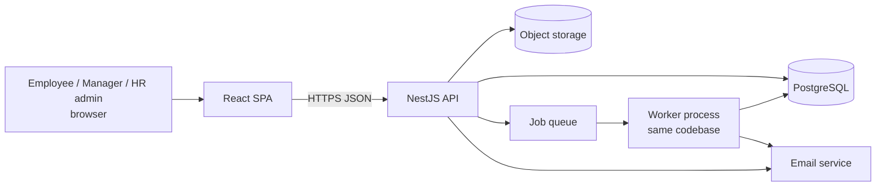
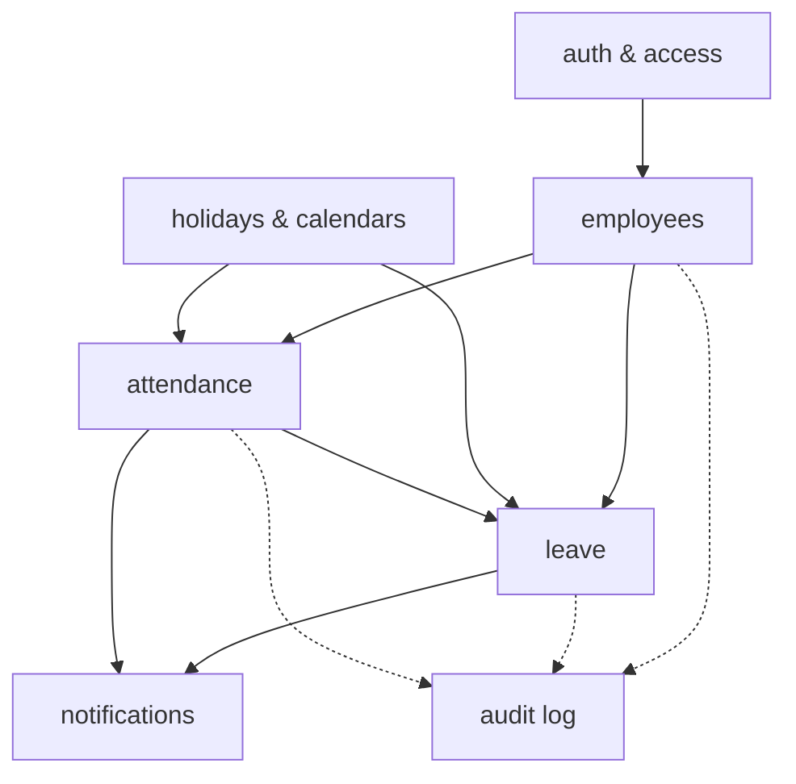
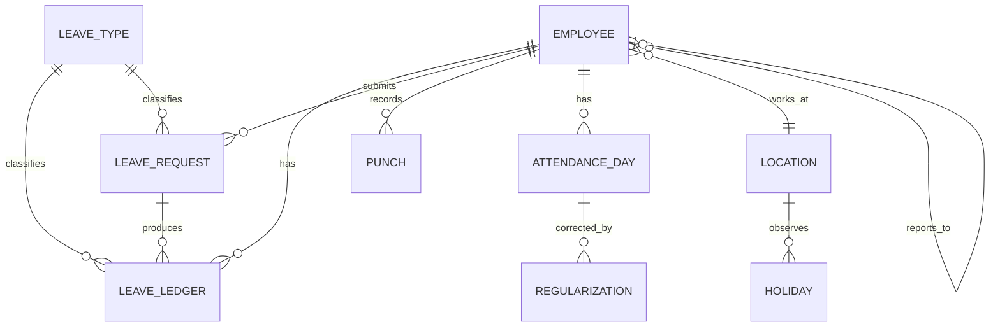

# HRMS Architecture

This document describes how the HRMS will be built. It follows the findings and rules in [RESEARCH.md](RESEARCH.md) (rule numbers like R2 refer to section 9 there). Version 1 targets a single company in India, with Karnataka as the reference state for statutory rules.

**Status:** proposed. The tech stack below is a default I chose to get started, and every choice is open to change before code is written.

## 1. Goals and scope

**Version 1 covers:**
- Employee master data with immutable employee codes
- Leave: types, ledger-based balances, apply/approve/cancel, accrual and year-end jobs
- Holiday calendars per location
- Attendance: raw punches, derived daily status, regularization, WFH
- Roles and access control, audit log

**Out of scope for v1:** payroll calculation, statutory filings (PF/ESI/TDS), recruitment, performance reviews, multi-company tenancy. The design leaves room for payroll to read attendance and leave data later.

**Quality goals, in priority order:**
1. **Correctness and auditability** - every leave balance and attendance status can be explained from stored records.
2. **Privacy** - sensitive fields (Aadhaar, PAN, bank, salary) are protected as described in RESEARCH.md section 1 and the DPDP Act.
3. **Configurability** - leave rules, holidays and attendance thresholds are data, not code.
4. **Simplicity** - small team, one deployable unit.

## 2. Tech stack (proposed)

| Layer | Choice | Why |
|---|---|---|
| Frontend | React + TypeScript (Vite) | Common, typed, good ecosystem for forms and tables |
| Backend | Node.js + NestJS (TypeScript) | Modular structure maps to the domain modules below; one language end to end |
| Database | PostgreSQL | Transactions and constraints matter for ledgers; row-level locks; JSONB for policy config |
| ORM / migrations | Prisma | Typed queries, versioned migrations |
| Background jobs | BullMQ on Redis (or pg-boss to avoid Redis) | Monthly accrual, year-end processing, escalations, reminders |
| Auth | Email + password with Argon2, short-lived JWT access token and rotating refresh token; SSO (OIDC) later | Self-contained for v1 |
| File storage | S3-compatible bucket | Medical certificates, documents |
| Email / push | SMTP provider, web push later | Approval notifications |
| Hosting | Docker containers; single region in India (for example AWS ap-south-1) | Data residency and simple deploys |
| CI | GitHub Actions: lint, typecheck, test, build | Repo is already on GitHub |

## 3. System overview



**Style: modular monolith.** One codebase, one database, split into modules with clear boundaries. The API and the worker are the same code started in two modes. Microservices would add operational cost with no benefit at this size; module boundaries keep that option open.

## 4. Modules



| Module | Responsibility |
|---|---|
| **auth** | Login, sessions, roles (employee, manager, HR admin, system admin), permission checks |
| **employees** | Employee master, employee code generation, org structure (department, manager, location), statutory IDs, bank details |
| **holidays** | Holiday calendar per (location, year), types national / state / restricted, weekly-off patterns |
| **leave** | Leave types and policy config, ledger, applications, approvals, accrual and year-end jobs |
| **attendance** | Raw punches, daily status derivation, regularization requests, WFH requests, month lock |
| **notifications** | Email (and later push) on submit, approve, reject, escalation |
| **audit** | Append-only record of who did what and who viewed sensitive fields |

Rules: a module talks to another only through its exported service interface, never by reading its tables directly. Attendance asks leave for "is this employee on approved leave that day" and the reverse follows the same route.

## 5. Data model (core entities)



| Entity | Key fields and notes |
|---|---|
| **employee** | `id` (internal UUID), `employee_code` (unique, generated from a DB sequence, never updated), name, DOB, gender, joining date, exit date, status, `employment_type`, `location_id`, `manager_id`, department. Never hard-deleted; status moves to inactive (RESEARCH.md section 2). |
| **employee_private** | Separate table for sensitive data: PAN, Aadhaar, UAN, bank account, IFSC, salary. Fields encrypted at the application layer; reads are audited. |
| **location** | Name, state, weekly-off pattern, timezone. Drives which holiday list applies. |
| **holiday** | `location_id`, date, name, `type` (national / state / restricted). Unique per (location, date). |
| **leave_type** | Code (CL, SL, EL, MAT, PAT, COMPOFF, LOP), accrual mode (upfront / monthly / on-request), annual quota, carry-forward cap, encashable flag, max consecutive days, gender restriction, expiry days, statutory floor. The policy rules R6 to R12 live here as data. |
| **leave_ledger** | Append-only rows: `employee_id`, `leave_type_id`, `entry_date`, `delta` (+credit / -debit, in half-day steps), `reason` (accrual, application, cancellation, lapse, carry_forward, encashment, expiry, adjustment), `ref_id` (request or job run). The balance is the sum (R2, R25). Rows are never updated or deleted; corrections are new rows. |
| **leave_request** | Employee, type, start, end, half-day flag and half (first or second), reason, status (pending, approved, rejected, cancelled), approver, decided at, attachment. |
| **punch** | Employee, timestamp, direction (in / out), source (web, mobile, device import). Immutable. |
| **attendance_day** | Employee, date, derived status (present, half_day, absent, leave, holiday, weekly_off, wfh), first in, last out, hours worked, late flag, `locked` flag. Derived from punches, leave, holidays and WFH. |
| **regularization** | Day, requested status or times, reason, status, approver. Approving it changes `attendance_day`, never `punch` (R28, RESEARCH.md section 7). |
| **wfh_request** | Employee, date, status. |
| **job_run** | Job name, period, started / finished, result. Used for idempotency of accrual and year-end runs. |
| **audit_log** | Actor, action, entity, entity id, before / after summary, timestamp, IP. Append-only. Also records views of employee_private. |

## 6. Key design decisions

1. **Leave balance is a ledger, not a column.** A balance is `SUM(delta)` per employee and type. Applying leave writes a debit row inside the same transaction as the request approval; cancelling writes an offsetting credit. This answers "why did my balance change" and removes the trust problem from the interview in RESEARCH.md section 8.
2. **Concurrency control.** Approving or applying leave locks the employee's rows for that leave type (`SELECT ... FOR UPDATE` on an employee-type balance row, or an advisory lock) so two requests cannot both spend the last day.
3. **Idempotent jobs.** Each accrual or year-end run has a unique key (job name + employee + period) recorded in `job_run` and the ledger `ref_id`. Running a job twice produces no duplicate rows (R25).
4. **Policy as data.** Quotas, caps and thresholds are read from `leave_type` and an `attendance_policy` config row, so changing "CL = 8" to "CL = 12" needs no deploy. Changes are versioned with an effective date so past calculations stay reproducible.
5. **Derived vs raw attendance.** Punches are immutable facts. `attendance_day` is recomputed from them, leave, holidays and WFH, and frozen by the month lock after payroll cut-off.
6. **Statute or policy, whichever is better.** The leave service computes entitlement as `max(policy, statutory_floor)` per type (R4, R8).
7. **Immutable employee code.** Generated by a database sequence, protected by a DB trigger or revoked UPDATE permission on the column, and absent from every update DTO (RESEARCH.md section 2).
8. **Location-based holidays.** An employee's holidays come from their `location_id`; leave day counting skips weekly offs and holidays for that location (R3).
9. **Time handling.** Store timestamps in UTC, convert to the location's timezone (IST for all v1 locations) when computing dates. Leave and holiday dates are plain `date` values with no timezone.

## 7. Request flow example: apply for leave

1. Employee submits the form. The SPA calls `POST /leave-requests`.
2. The API authenticates the user, then validates the payload.
3. The leave module checks, in order: employee is active (R5), dates are valid and backdating limit holds (R19), no overlap with approved or pending leave (R17), type rules such as gender and max consecutive days (R6, R9, R10), and the working-day count after removing weekly offs and holidays (R3).
4. Balance check against the ledger sum (R18); a shortfall is rejected unless the employee chose to convert it to LOP.
5. The request is saved as `pending` and a notification goes to the manager.
6. On approval, one transaction writes the ledger debit, updates the request, and writes an audit entry. After commit, notifications go to the employee, and attendance recomputes the affected days.
7. If the manager does nothing for 5 working days, the escalation job notifies HR (R20).

## 8. API design

- REST over HTTPS, JSON, versioned under `/api/v1`.
- Resource style: `/employees`, `/leave-requests`, `/leave-balances`, `/holidays`, `/attendance/days`, `/attendance/regularizations`.
- Actions that are not simple CRUD use sub-resources, for example `POST /leave-requests/{id}/approve`, `.../reject`, `.../cancel`.
- Input validation at the edge with schemas; all errors use one structure with a code, message and field errors.
- Pagination on every list endpoint; filters by date range, status and employee.
- An OpenAPI document is generated from the code and committed or published for the frontend.
- Sensitive fields are returned masked by default (last four digits). A separate permissioned endpoint returns the full value and writes an audit entry.
- Employee codes and other IDs go in paths or bodies, never sensitive identifiers like Aadhaar or PAN.

## 9. Security and privacy

- **Authentication:** Argon2 password hashes, rate-limited login, short-lived access tokens, rotating refresh tokens, optional TOTP, session revocation on password change.
- **Authorization:** role-based plus relationship checks. An employee sees only their own data; a manager sees direct reports; HR admin sees everyone but not necessarily salary; only specific roles see employee_private. Checks live in the service layer, not only in the UI.
- **Data protection:** TLS everywhere, database encryption at rest, application-level encryption for PAN / Aadhaar / bank fields with keys held in a secrets manager, field masking in API responses and UI.
- **Logging:** structured logs with no personal identifiers or tokens; request IDs for tracing.
- **Audit:** append-only `audit_log` for changes and for views of sensitive fields.
- **DPDP alignment:** collect the minimum, record the purpose, support correction and access requests, define retention and deletion for ex-employees (statutory record retention applies), and breach-response steps.
- **Application security:** parameterized queries via the ORM, output encoding, CSRF protection if cookies are used, security headers, dependency scanning in CI.
- **Backups:** daily encrypted backups with point-in-time recovery, restore tested regularly.

## 10. Frontend structure

- Routes by role: Employee (dashboard, apply leave, my balance statement, attendance, regularization), Manager (approval inbox, team calendar), HR (employees, leave types, holidays, reports).
- Server state with TanStack Query, forms with React Hook Form and schema validation, a component library for tables and dialogs.
- Features from the interview in RESEARCH.md: balance statement showing every credit and debit, holiday calendar for the user's own location, bulk regularization, approval notifications, policy text next to the field it affects, and a mobile-friendly layout.
- Accessibility: keyboard navigation and labelled form controls.

## 11. Repository layout (proposed)

```
HRMS/
  apps/
    api/            NestJS app (modules: auth, employees, holidays, leave, attendance, notifications, audit)
    web/            React app
  packages/
    shared/         shared types, validation schemas, constants
  prisma/           schema.prisma, migrations, seed
  docs/             extra design notes
  RESEARCH.md
  ARCHITECTURE.md
  README.md
```

## 12. Testing strategy

- **Unit tests** for the rule logic: pro-rating (R13), EL accrual with LOP (R14), working-day counting (R3), late and half-day thresholds (R26, R27). These are pure functions and the highest-value tests.
- **Integration tests** against a real PostgreSQL instance (container) for ledger writes, overlap checks and concurrency (two simultaneous approvals on the last day).
- **Job tests** that run accrual and year-end twice and assert no duplicate ledger rows.
- **API tests** for permissions: an employee cannot read another employee's data; masking works.
- **End-to-end tests** (Playwright) for the main flows: apply, approve, cancel, regularize.
- CI runs lint, typecheck and tests on every pull request.

## 13. Deployment and operations

- Docker images for api (also run as worker) and web. Environments: local (Docker Compose with Postgres and Redis), staging, production.
- Config from environment variables; secrets in a secrets manager, never in the repo (`.env` is already git-ignored).
- Database migrations run as a separate release step, forward-only, with backups before production runs.
- Monitoring: health endpoint, error tracking, metrics on request latency and job success, alerts on failed jobs.
- Scheduled jobs: monthly EL accrual (last day of month), year-end run (31 Dec), comp-off expiry (daily), approval escalation (daily), month lock (after payroll cut-off).

## 14. Delivery phases

1. **Foundation:** repo structure, CI, database, auth, roles, audit logging.
2. **Employees:** master data, employee code generation, org structure, masked sensitive fields.
3. **Holidays and leave:** leave types config, ledger, apply / approve / cancel, accrual and year-end jobs, balance statement.
4. **Attendance:** punches, derived status, regularization, WFH, month lock.
5. **Notifications and reports:** approval emails, escalation, leave and attendance reports.
6. **Hardening:** security review, performance, backup restore drill, pilot with a real team.

## 15. Open questions

- Confirm the stack with the team (NestJS vs another backend, Redis vs pg-boss).
- Exact Karnataka statutory casual / sick leave and holiday entitlements (open item in RESEARCH.md).
- Single company or multi-tenant from day one? v1 assumes single company.
- Source of punches: web check-in only, or integration with biometric devices?
- Leave year: January to December (assumed) or April to March.
- Are restricted holidays in v1?
- Data retention periods for ex-employee records.
